<!-- @format -->

# Flutter X Widgets · Flutter 实验室

> 一个精心打造的 **Flutter 动画 / 交互组件 Showcase**。
> 内置 **28 个独立组件示例** 与 **16 个完整 Demo App**，专注于动效与交互设计。

[](https://flutter.dev)
[](https://dart.dev)
[](https://flutter.dev)
[](LICENSE)

---

## 📑 目录

- [✨ 项目预览](#-项目预览)
- [🎯 项目特色](#-项目特色)
- [🧩 组件示例（28）](#-组件示例28)
- [📱 Demo App（16）](#-demo-app16)
- [🚀 快速开始](#-快速开始)
- [🛠 技术栈](#-技术栈)
- [📁 项目结构](#-项目结构)
- [⚠️ 注意事项](#-注意事项)
- [🤝 问题反馈 & 贡献](#-问题反馈--贡献)
- [📄 许可证](#-许可证)

---

## ✨ 项目预览

`lib/main.dart` 启动后进入 `HomeScreen`，以 **「组件」 / 「DemoAPP」** 双 Tab + 2 列网格呈现所有 demo。每个卡片包裹 `Hero` 动画，点击后通过 `MaterialPageRoute` 进入对应页面（支持 `isFullScreen` 全屏模式）。

<p align="center">
  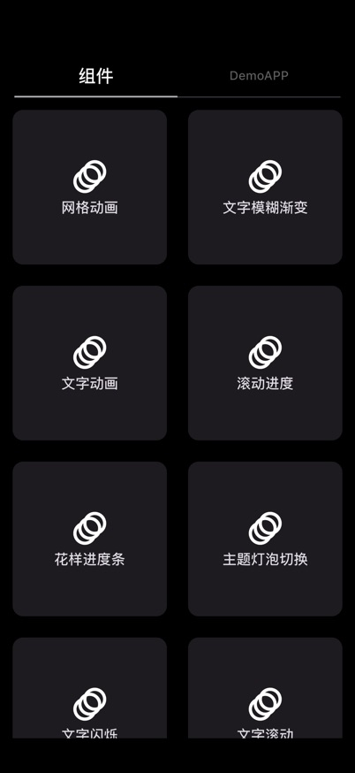
</p>

## 🎯 项目特色

- **🎨 28 个独立组件**：覆盖文字动画、加载器、卡片、进度条、AppBar、主题切换等场景
- **📱 16 个完整 App**：从「3D 计算器」到「拾页手账」，把多个组件组合成完整产品形态
- **🧪 案例工程化**：APP-14 起遵循 [`docs/APP_DEMO_CODE_SPEC.md`](docs/APP_DEMO_CODE_SPEC.md) —— 独立应用壳、分层目录、纯规则层 + 本地存档、随案例交付文档与 Widget 测试
- **🪄 重点关注动效**：自带 `flutter_shaders` + Impeller 片元着色器、`flutter_animate`、`forge2d` 物理引擎、`flutter_3d_controller`
- **🎧 多媒体能力**：集成 `just_audio` / `just_waveform` 音频播放与可视化，`flutter_tts` 语音播报，`image_picker` 相册选图
- **♿ 动效可降级**：新案例统一响应系统「减少动态效果」，并做了无障碍标签与文字缩放适配
- **🌗 黑金主题**：纯黑底 + 自定义字体（`NeumaticGothic` + `SF Pro Display`）

## 🧩 组件示例（28）

| # | 名称 | 路径 |
|---|------|------|
| 01 | 网格动画 | `lib/example/grid_animation` |
| 02 | 文字模糊渐变 | `lib/example/blurfade` |
| 03 | 文字动画 | `lib/example/text_reveal` |
| 04 | 滚动进度 | `lib/example/scroll_progress` |
| 05 | 花样进度条 | `lib/example/progress` |
| 06 | 主题灯泡切换 | `lib/example/theme_mode` |
| 07 | 文字闪烁 | `lib/example/text_shine` |
| 08 | 文字滚动 | `lib/example/text_hyper` |
| 09 | 自定义滑动列表 | `lib/example/card_scroll` |
| 10 | 点阵图案 | `lib/example/dots` |
| 11 | Gemini Loading 飞溅 | `lib/example/gemini_splash` |
| 12 | 呼吸动画 | `lib/example/background_ripples` |
| 13 | 相片效果 | `lib/example/photo_effect` |
| 14 | 日历效果 | `lib/example/calendar` |
| 15 | 通知列表 | `lib/example/notification_list` |
| 16 | 庆祝动画 | `lib/example/celebrate` |
| 17 | 方形加载器 | `lib/example/loader_square` |
| 18 | 摇杆卡片 | `lib/example/card_scroll_joystick` |
| 19 | 边框线条动画 | `lib/example/border_beam` |
| 20 | 卡片霓虹灯背景 | `lib/example/neon_card` |
| 21 | 卡片堆叠提示 | `lib/example/stacked_cards` |
| 22 | 文字控制器 | `lib/example/text_on_path` |
| 23 | 球形加载器 | `lib/example/loader_sphere` |
| 24 | 书本翻开 | `lib/example/book_open` |
| 25 | 自定义 AppBar | `lib/example/custom_appbar` |
| 26 | 文件夹动画 | `lib/example/folder_shape` |
| 27 | 头像加载 | `lib/example/loader_avatars` |
| 28 | 水滴按钮 | `lib/example/water_drop_button` |

### 🖼 组件截图

> 截图为 iPhone 18 Pro 模拟器运行画面，按上表编号排列。

|  |  |  |  |
|:---:|:---:|:---:|:---:|
| 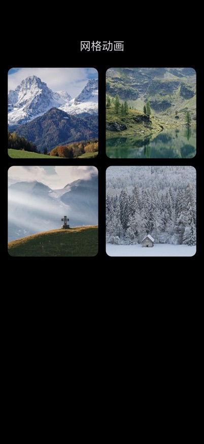<br><sub>01 网格动画</sub> | 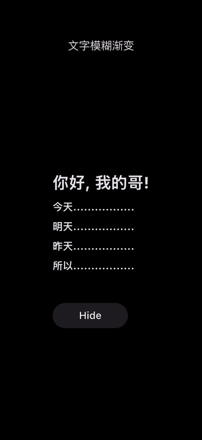<br><sub>02 文字模糊渐变</sub> | 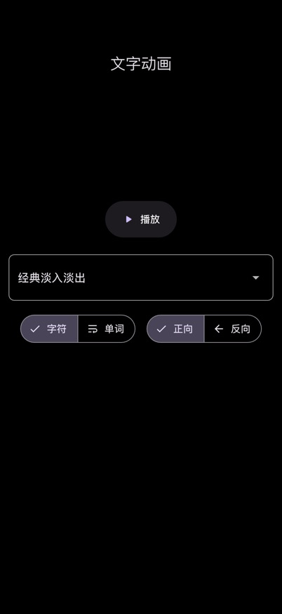<br><sub>03 文字动画</sub> | 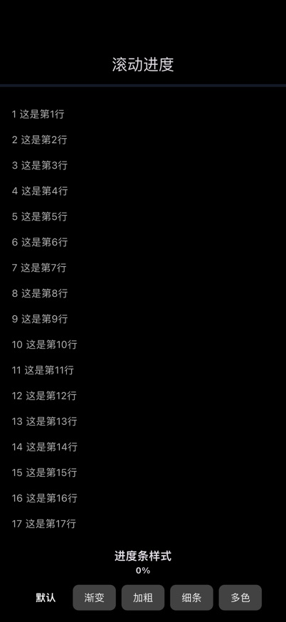<br><sub>04 滚动进度</sub> |
| 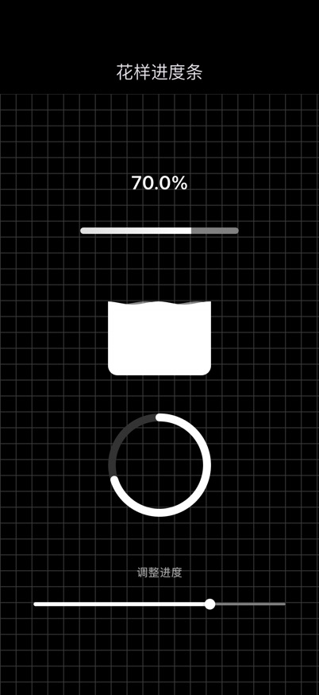<br><sub>05 花样进度条</sub> | 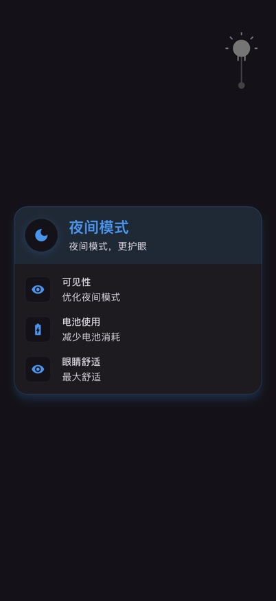<br><sub>06 主题灯泡切换</sub> | 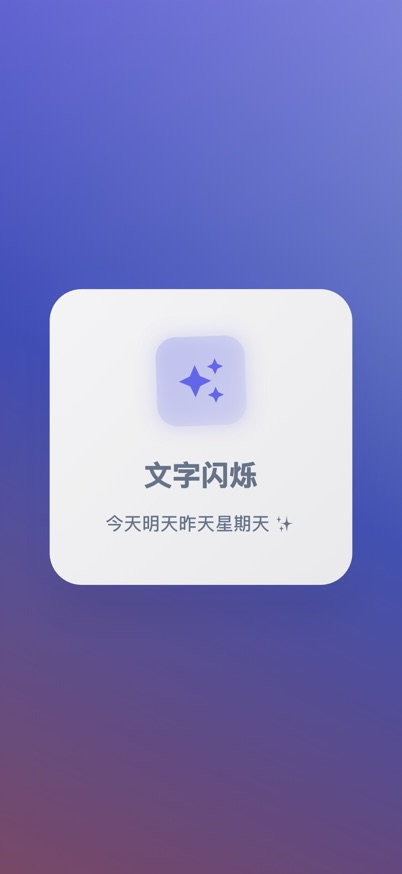<br><sub>07 文字闪烁</sub> | <br><sub>08 文字滚动</sub> |
| 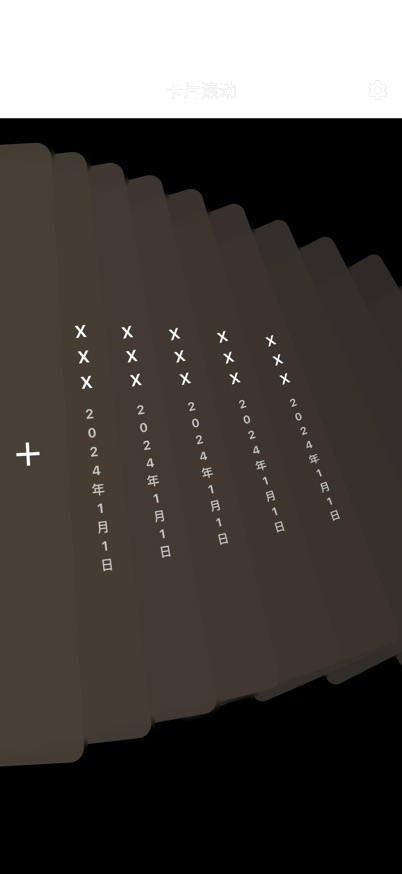<br><sub>09 自定义滑动列表</sub> | 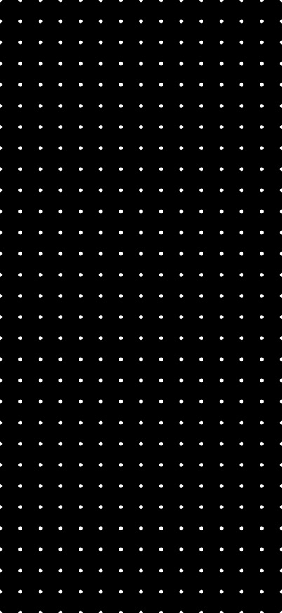<br><sub>10 点阵图案</sub> | <br><sub>11 Gemini Loading 飞溅</sub> | 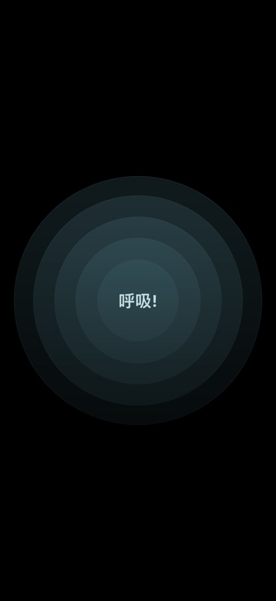<br><sub>12 呼吸动画</sub> |
| 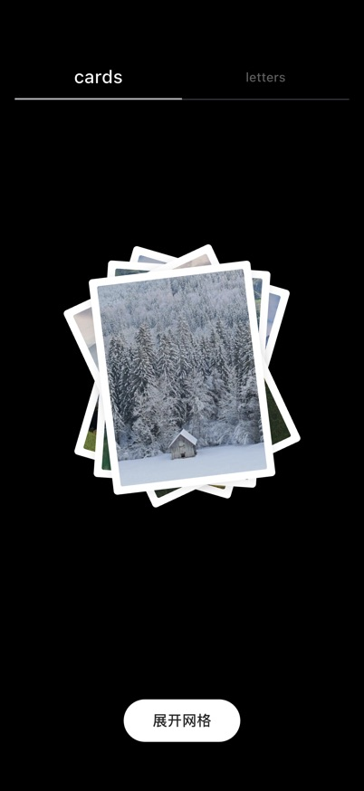<br><sub>13 相片效果</sub> | 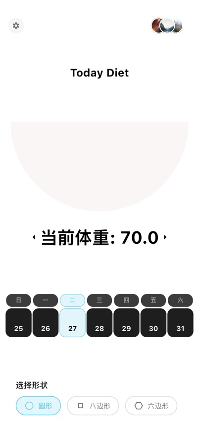<br><sub>14 日历效果</sub> | 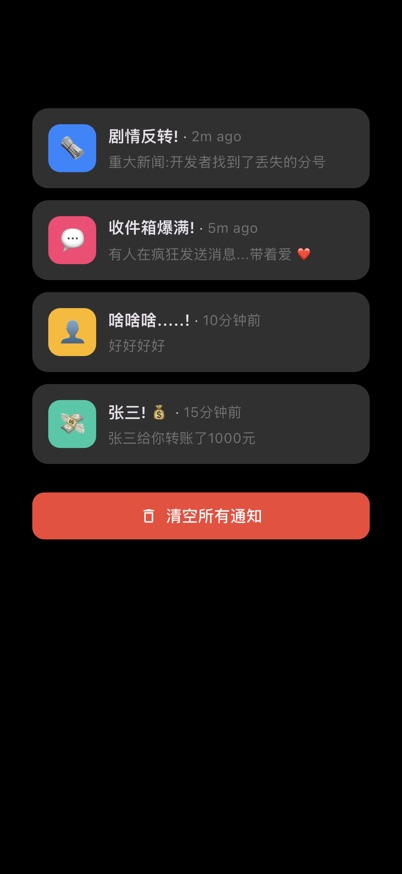<br><sub>15 通知列表</sub> | <br><sub>16 庆祝动画</sub> |
| 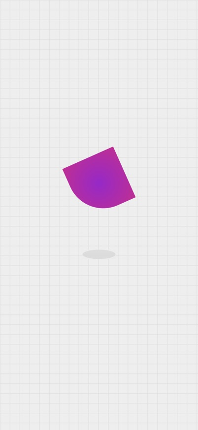<br><sub>17 方形加载器</sub> | 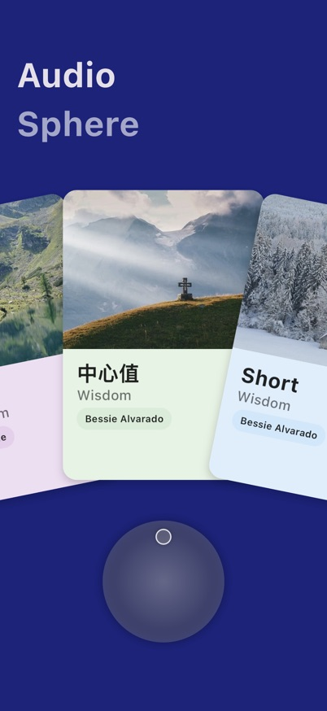<br><sub>18 摇杆卡片</sub> | 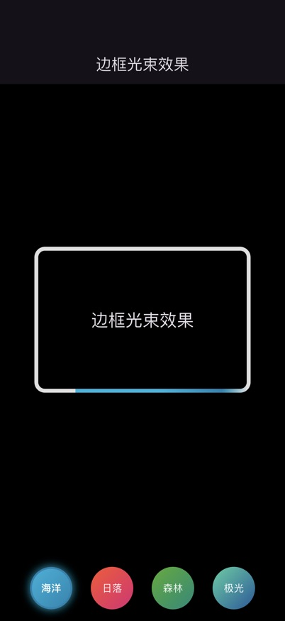<br><sub>19 边框线条动画</sub> | 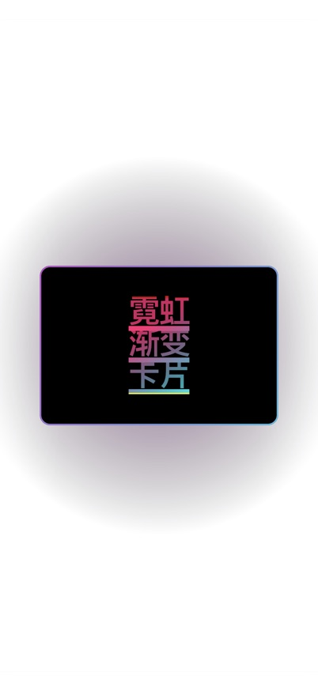<br><sub>20 卡片霓虹灯背景</sub> |
| 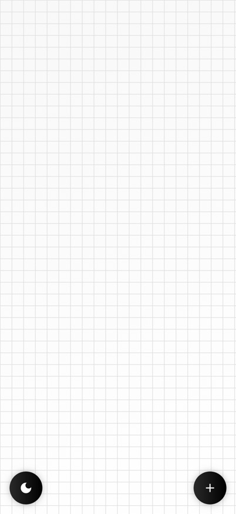<br><sub>21 卡片堆叠提示</sub> | 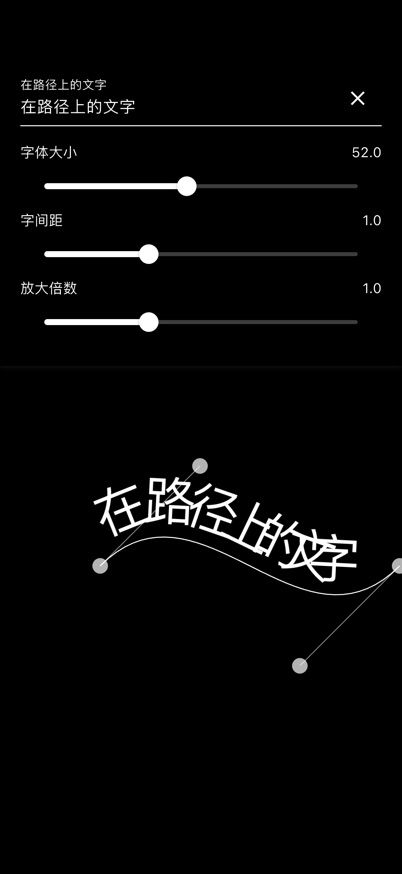<br><sub>22 文字控制器</sub> | 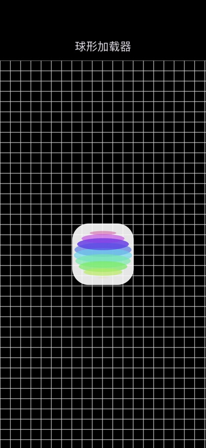<br><sub>23 球形加载器</sub> | 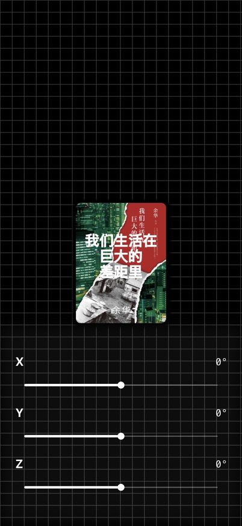<br><sub>24 书本翻开</sub> |
| 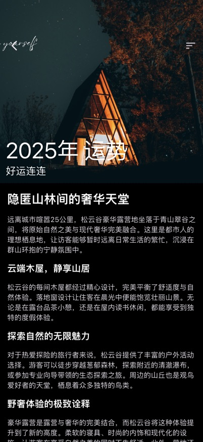<br><sub>25 自定义 AppBar</sub> | 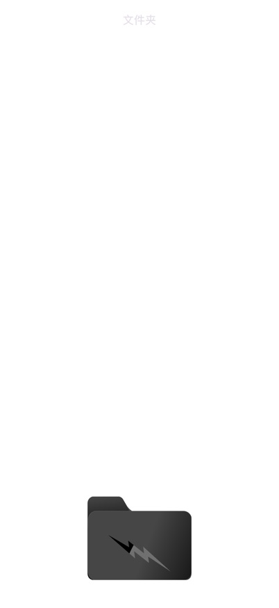<br><sub>26 文件夹动画</sub> | 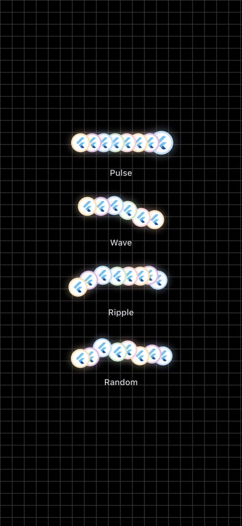<br><sub>27 头像加载</sub> | <br><sub>28 水滴按钮</sub> |

## 📱 Demo App（16）

| # | 名称 | 路径 |
|---|------|------|
| 01 | 今日训练 | `lib/app_demo/01` |
| 02 | 户外训练 TODO | `lib/app_demo/02` |
| 03 | 饮食清单 | `lib/app_demo/03` |
| 04 | 3D 计算器 | `lib/app_demo/04` |
| 05 | 认知训练 | `lib/app_demo/05` |
| 06 | iOS26 玻璃效果 | `lib/app_demo/06` |
| 07 | iOS26 桌面 | `lib/app_demo/07` |
| 08 | 待办事项 | `lib/app_demo/08` |
| 09 | 一起听音乐 | `lib/app_demo/09` |
| 10 | 学习笔记 | `lib/app_demo/10` |
| 11 | 图片编辑器 | `lib/app_demo/11` |
| 12 | 积字成山待办 | `lib/app_demo/12` |
| 13 | 流光聊天 | `lib/app_demo/13` |
| 14 | 聚会游戏盒 | `lib/app_demo/14` |
| 15 | Pip 英语学习 | `lib/app_demo/15` |
| 16 | 拾页手账 | `lib/app_demo/16` |

### 🆕 最近三个案例

三个案例的 `docs/README.md` 都只记录已实现并验证过的行为；APP-15 / APP-16 还各自保留了完整的产品交接包（`docs/*-handoff/`：实现规格、种子数据、素材与参考图），APP-14 附带实现说明 `docs/FLUTTER_AI_IMPLEMENTATION_BRIEF.md`，可对照阅读。

- **APP-14 · 聚会游戏盒** —— 斜切色带菜单配逐行错峰分页，标题区页码直接绑定分页进度；抛硬币与掷骰子各有独立回合状态机（硬币 `idle → running → revealing → result`，骰子走 3D 面朝向 + 运动计划），一轮只抽取一次结果，切后台直接结算不重抽。
- **APP-15 · Pip 英语学习** —— 学习路径、选词填空、听音选图、课后结算、复习词卡、成就与个人目标；`just_audio` 播放本地 WAV、`flutter_tts` 兜底发音，进度写进独立命名空间的本地存档（串行写入 + 跨天重置）。
- **APP-16 · 拾页手账** —— 纸面拼贴（拍立得 / 贴纸 / 胶带 / 便签）按住拖动、15 步撤销；`image_picker` 选图后压缩校验再落盘，`uuid` 命名持久路径；手账 / 素材 / 翻看三页用 `IndexedStack` 保留滚动与选中状态。

### 🖼 案例截图

> 每个案例进入后的首屏，按上表编号排列。

|  |  |  |  |
|:---:|:---:|:---:|:---:|
| 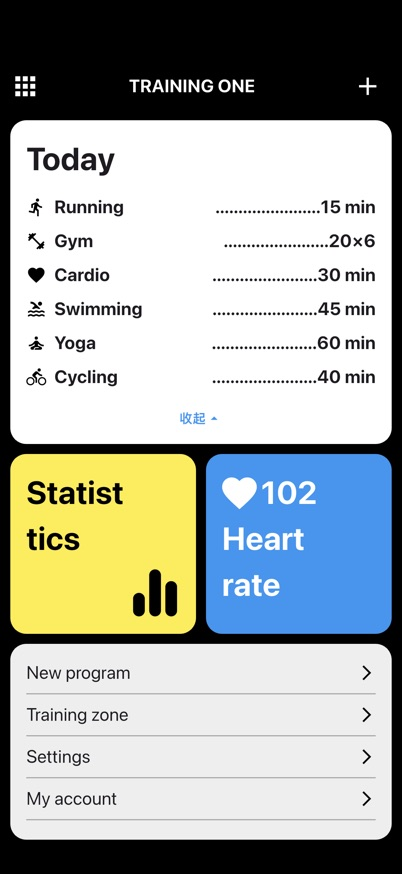<br><sub>01 今日训练</sub> | 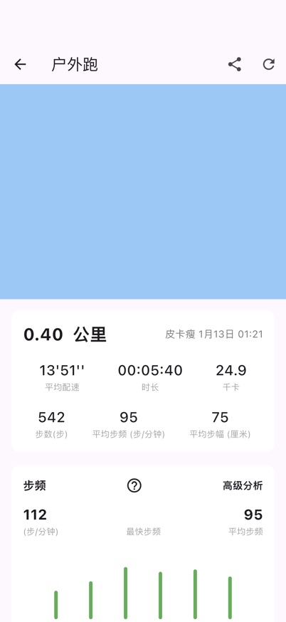<br><sub>02 户外训练 TODO</sub> | 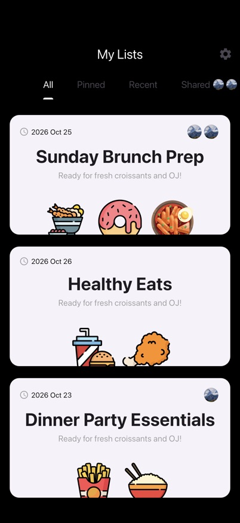<br><sub>03 饮食清单</sub> | 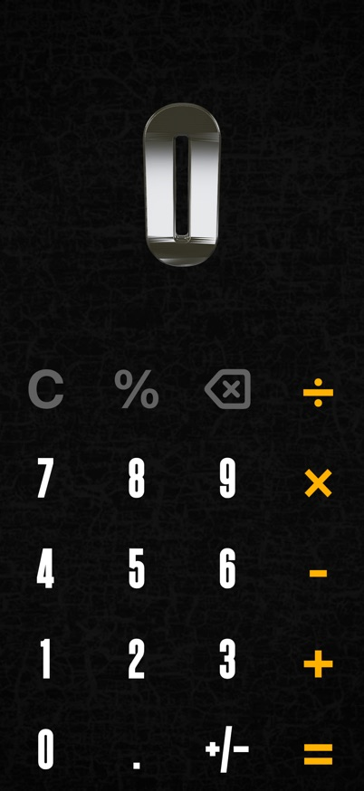<br><sub>04 3D 计算器</sub> |
| 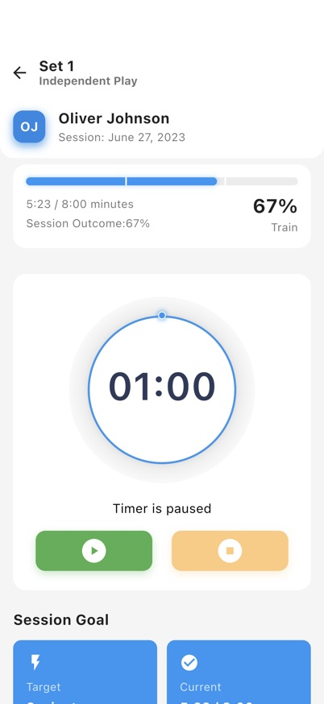<br><sub>05 认知训练</sub> | <br><sub>06 iOS26 玻璃效果</sub> | 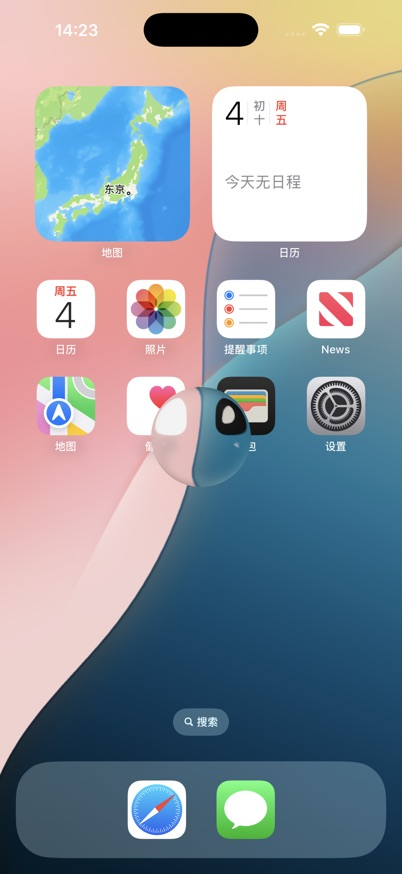<br><sub>07 iOS26 桌面</sub> | 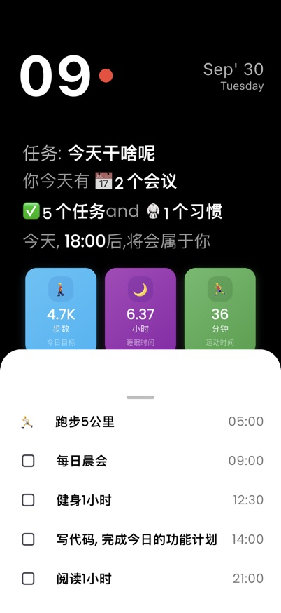<br><sub>08 待办事项</sub> |
| 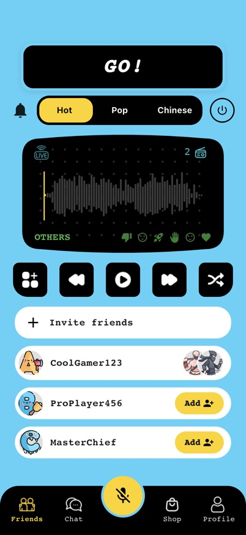<br><sub>09 一起听音乐</sub> | 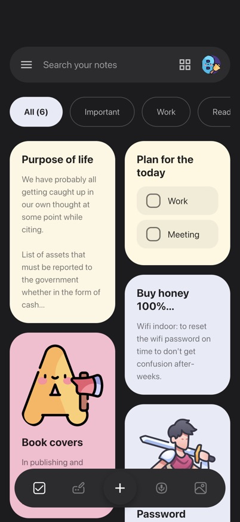<br><sub>10 学习笔记</sub> | 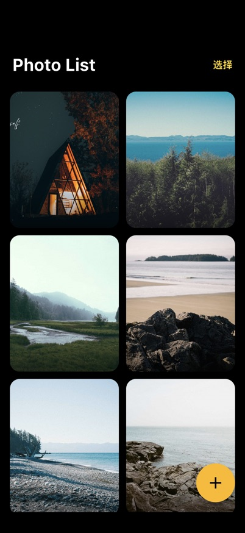<br><sub>11 图片编辑器</sub> | 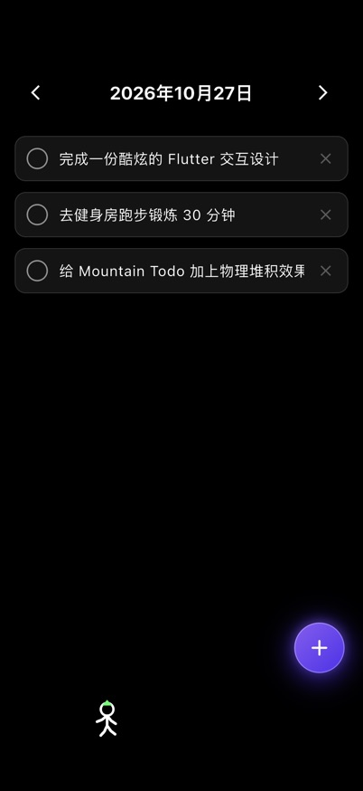<br><sub>12 积字成山待办</sub> |
| 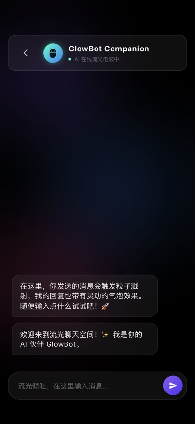<br><sub>13 流光聊天</sub> | <br><sub>14 聚会游戏盒</sub> | 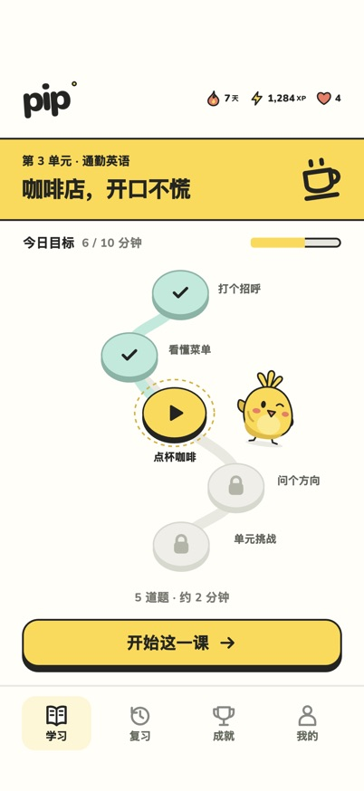<br><sub>15 Pip 英语学习</sub> | 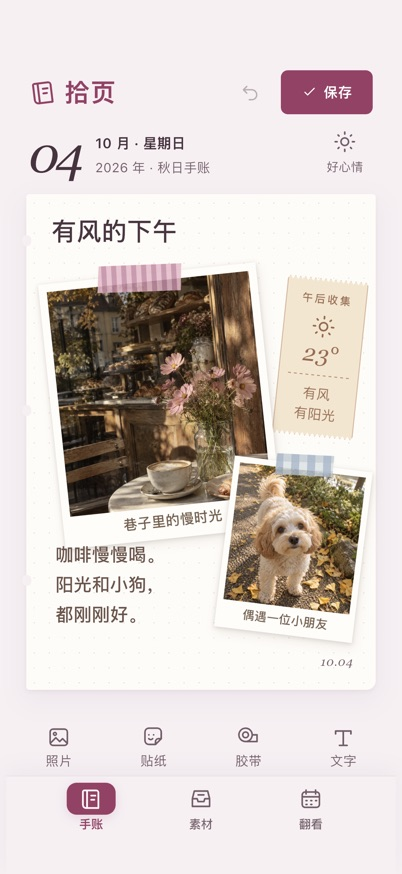<br><sub>16 拾页手账</sub> |

> 重新生成截图：`flutter drive --driver=test_driver/integration_test.dart --target=integration_test/readme_screenshots_test.dart -d <simulator-id>`。APP-04 的 3D 模型是原生平台视图，Flutter 侧截图拍不到，需在测试输出 `READY_FOR_NATIVE_SCREENSHOT` 后用 `xcrun simctl io booted screenshot` 补拍。

---

## 🚀 快速开始

### 环境要求

- **Flutter**：3.35 及以上
- **Dart SDK**：^3.7.0
- **推荐设备**：iPhone 6 模拟器（其它 iPhone 模拟器亦可，但 iPhone 6 是基准尺寸）

### 安装 & 运行

```bash
# 1. 克隆仓库
git clone <repo-url>
cd flutter_ani_widgets

# 2. 获取依赖
flutter pub get

# 3. 启动 iPhone 6 模拟器
open -a Simulator --args -CurrentDeviceUDID <iPhone-6-UDID>

# 4. 运行项目
flutter run
```

也可直接在 IDE（VSCode / Cursor / Android Studio）中打开，按 F5 选择 iPhone 6 模拟器运行。

### 🟦 在 VSCode / Cursor 与 Zed 中开发

两套项目配置提供等效的运行、调试与维护能力，但调试界面不同：VS Code / Cursor 使用 Dart/Flutter 扩展的调试会话；Zed 通过终端运行 Flutter CLI，并在浏览器中的 DevTools 调试。`.vscode/` 提供 `settings.json`、`extensions.json`、`launch.json` 和 `tasks.json`；`.zed/` 提供 `settings.json` 和 `tasks.json`。两边均使用 Dart 保存时格式化、2 空格缩进和 140 列宽。

| 操作 | VS Code / Cursor | Zed（命令面板 → `task: spawn`） |
|---|---|---|
| Debug 启动 | Run and Debug → **Flutter: Run (Debug)** | **Flutter 模拟器启动 (debug)** |
| Profile 启动 | Run and Debug → **Flutter: Run (Profile)** | **Flutter 模拟器启动 (profile)** |
| 附加到运行中的应用 | Run and Debug → **Flutter: Attach** | **Flutter attach (已运行实例)** |
| 断点、变量与单步 | IDE 调试器；需要时用 Dart 扩展命令打开 DevTools | **Dart DevTools (Web)**，手动连接 VM Service URI 后在 Debugger 操作 |
| 获取依赖 / 静态分析 / 清理 | Tasks: Run Task → `flutter pub get` / `flutter analyze` / `flutter clean` | **Flutter pub get** / **Flutter analyze** / **Flutter clean** |
| iOS Debug 构建 | Tasks: Run Task → **Flutter: Build iOS (Debug)** | **Flutter 构建 iOS (debug)** |

**设备选择**：共享配置不固定设备 ID。VS Code / Cursor 每次启动前在 Flutter 设备选择器中主动选目标；Zed 运行前确认设备，多设备时按 Flutter CLI 的实际提示选择，若未出现选择提示，则在当次终端命令中追加 `-d <设备 ID>`。Attach 也应按当前运行的设备或实例选择目标。Profile 模式需使用支持该模式的设备。

**Zed 的 DevTools 流程**：运行 Debug 任务后，从 `flutter run` 输出复制 **VM Service URI**；再启动 **Dart DevTools (Web)**，在打开的页面中输入该 URI 并连接。无参数的 `dart devtools` 不会自动关联正在运行的应用，`--print-dtd` 输出的 DTD URI 也不能当作 VM Service URI。Zed 的 `flutter run` 终端可用 `r` 热重载、`R` 热重启、`q` 退出；断点、变量和单步操作在已连接的 DevTools Debugger 中进行，不是终端快捷键。

### 仅启动一个 Demo

如果只想看某一个 demo，可以在 `lib/main.dart` 的 `AnimationExample` 列表里只保留对应条目，其他全部删掉，再 `flutter run`。

---

## 🛠 技术栈

| 类别 | 技术 |
|------|------|
| 框架 | Flutter 3.35+ / Dart ^3.7.0 |
| 动画 | `flutter_animate` |
| 着色器 | `flutter_shaders` + `shaders/impeller.frag` |
| 物理 | `forge2d`（2D 物理引擎） |
| 3D | `flutter_3d_controller` |
| 音频 | `just_audio` + `just_waveform` |
| 语音 | `flutter_tts` |
| 富文本 | `super_editor` (0.3.0-dev.40) |
| 日历 | `table_calendar` |
| 字体 | `google_fonts` + 自带 `NeumaticGothic` / `SF Pro Display` |
| 图标 | `flutter_svg` |
| 网络图 | `cached_network_image` |
| 相册 | `image_picker` |
| 分享 | `share_plus` |
| 表达式 | `math_expressions` |
| 本地存储 | `shared_preferences` |
| 路径 / 文件 | `path` / `path_provider` / `uuid` |
| 值对象 / 日期 | `equatable` / `intl` |

---

## 📁 项目结构

```text
flutter_ani_widgets/
├── lib/
│   ├── main.dart                      # Showcase 入口（「组件」/「DemoAPP」双 Tab）
│   ├── example/                       # 28 个独立组件示例
│   └── app_demo/                      # 16 个完整 Demo App（编号 01–16）
│       └── 16/                        # 新案例统一分层：models / screens / widgets / data / docs
├── assets/
│   ├── fonts/                         # NeumaticGothic、SF Pro Display
│   ├── images/                        # 通用图片资源，案例资源按 10 / 14 / 15 / 16 分目录
│   ├── 3d_numbers/                    # 3D 数字模型资源
│   └── audio/                         # 音频文件（含 APP-15 听力 WAV）
├── shaders/
│   └── impeller.frag                  # Impeller 片元着色器
├── docs/
│   ├── PROJECT_OVERVIEW.md            # 详细项目说明
│   ├── APP_DEMO_CODE_SPEC.md          # Demo App 工程规范（APP-14 起遵循）
│   └── screenshots/                   # README 截图（首页 / 组件 / 案例）
├── integration_test/                  # 截图生成用集成测试
├── test_driver/                       # 集成测试截图落盘驱动
├── test/                              # 单元 / Widget 测试（含 app_demo/14–16）
├── pubspec.yaml
└── README.md
```

> 📖 更详细的组件 / Demo 说明，请查看 [docs/PROJECT_OVERVIEW.md](docs/PROJECT_OVERVIEW.md)。
>
> 📝 变更历史请查看 [CHANGELOG.md](CHANGELOG.md)。

---

## ⚠️ 注意事项

- **iOS 优先**：当前版本主要针对 iOS 平台优化；Android 平台存在部分已知问题，正在修复中。
- **推荐 iPhone 6 模拟器**：可获得最佳展示效果（动效节奏与排版按其尺寸调校）。
- **新案例的设计画布**：APP-15 / APP-16 以 390×844 为设计基准，窗口更宽时内容居中、画布外铺底色，更窄时按实际宽度排版；早期案例仍按 iPhone 6 尺寸调校。
- **首次运行慢**：`forge2d`、`flutter_shaders`、`just_audio` 等 native 依赖首次编译时间较长，建议预留 3–5 分钟。
- **APK / IPA 体积**：因内置音频与图片资源，安装包会偏大，正式发布前建议压缩 / 抽离。

---

## 🤝 问题反馈 & 贡献

遇到任何问题，欢迎：

- 🐛 提交 [Issue](../../issues) 反馈 Bug
- 💡 提交 [Pull Request](../../pulls) 贡献代码 / 新组件 / 新 Demo
- ⭐ 给项目点 Star 支持作者

每一条反馈都会被看到，感谢你的参与 🙌

---

## 📄 许可证

本项目采用 **Apache License 2.0**。

完整许可文本请见根目录 [`LICENSE`](LICENSE) 文件。

---

<p align="center">Made with ❤️ & Flutter</p>